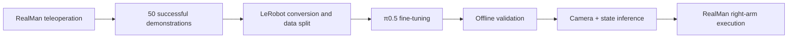

# π0.5 on RealMan: Banana Pick-and-Place 🍌

**50 teleoperated demonstrations → π0.5 fine-tuning → real-robot deployment.**

I fine-tuned the pretrained [π0.5 base](https://huggingface.co/lerobot/pi05_base) for a banana pick-and-place task and deployed it on a RealMan dual-arm laboratory platform. The right arm picks up an artificial banana, places it in a blue plate, releases it, and lifts clear.

**Highlight: 9/10 successful onsite trials** with the Expert-only checkpoint on November 8, 2026.

[中文说明](README.zh-CN.md) · [Experiment details](docs/experiment.md) · [Pipeline and interfaces](docs/reproduction.md)

## Demo

**[Watch the demo video (MP4)](assets/expert_pick_place_2x.mp4)** · GIF at 4× speed; MP4 at 2× speed.

## Results

| Fine-tuning | Selected checkpoint | Successful trials |
|---|---:|---:|
| **Expert-only** | **4,000 updates** | **9 / 10 (90%)** |
| LoRA (r=16, α=16) | 2,500 updates | 0 / 8 |

These are onsite pilot-session results, not a controlled head-to-head benchmark: the executor was adjusted during testing and starting conditions were not identical across all trials. The full evaluation record is in the [experiment card](docs/experiment.md).

Small changes in banana position and renewed grasp attempts after object removal were also observed, motivating further robustness tests.

## From demonstrations to deployment

| Component | Setup |
|---|---|
| Dataset | 50 demonstrations: 40 TRAIN / 5 VAL / 5 TEST |
| Observations | 3 RGB cameras (overhead, left wrist, right wrist), 14D robot state, task instruction |
| Actions | 14D joint/gripper targets; right arm executed on hardware |
| Training | AMD gfx1100 GPU, ~48 GiB VRAM, ROCm 7.2 |
| Deployment | NVIDIA RTX 3060, 12 GB |

The model uses the existing lab teleoperation and robot-control infrastructure. Training normalization was computed from TRAIN only; checkpoint selection used VAL, not TEST.

## Repository contents

- [Experiment card](docs/experiment.md): settings, measurements, observations, and evaluation protocol.
- [Pipeline and interface notes](docs/reproduction.md): collection, conversion, model interface, and deployment checks.
- [Pilot result summary](results/pilot_summary.json) and the demo media above.

This public repository shares the **demo and experiment documentation**; raw demonstrations, task weights, and lab-specific control code are not included.

## Next steps

- Run repeatable evaluations with a fixed executor and documented starting conditions.
- Measure performance under object-position changes and recovery scenarios.
- Investigate LoRA's initial-action offsets and action-chunk discontinuities.

## Acknowledgements

Built on [Physical Intelligence's OpenPI](https://github.com/Physical-Intelligence/openpi) and [Hugging Face LeRobot](https://github.com/huggingface/lerobot). Thanks to the lab members who developed and supported the RealMan platform, teleoperation, data collection.
