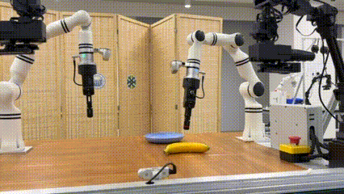
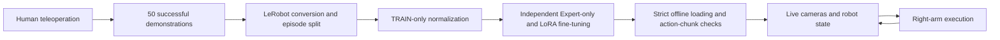

# realman-pi05-banana 🍌

**Fine-tuning π0.5 on 50 self-collected demonstrations for banana pick-and-place on a real RealMan robot.**

[中文说明](README.zh-CN.md) · [Experiment details](docs/experiment.md) · [Pipeline and interfaces](docs/reproduction.md)

## Demo

**[Watch / download the 2× MP4 video](assets/expert_pick_place_2x.mp4)**

The supplied video is shown at **2×** speed and the GIF at **4×** speed. These playback speeds are not real-time robot speed or inference latency measurements.

## What worked

Using the right arm, pick up an artificial banana from the left, place it in a blue plate on the right, release it, and lift the gripper clear of the plate.

| Fine-tuning method | Selected checkpoint | Onsite successes | Success fraction |
|---|---:|---:|---:|
| **Expert-only** | **step 4,000** | **9 / 10** | **90%** |
| LoRA, r16 / alpha16 | step 2,500 | 0 / 8 | 0% |

These are **operator-reported pilot-session results from November 8, 2026**. The executor was debugged during the session; identical code versions and initial conditions across all attempts have not been established. They describe these checkpoints and this task, rather than a general comparison of fine-tuning methods.

Expert-only is the current deployment candidate. Small banana-position changes and renewed grasp attempts after manual object removal were also observed. Those observations remain qualitative; the interrupted re-grasp was not evaluated to completion.

## From demonstrations to the robot

| Component | This experiment |
|---|---|
| Robot | RealMan dual-arm lab platform; right arm actuated, left arm observed |
| Policy | Pretrained [π0.5 base](https://huggingface.co/lerobot/pi05_base), fine-tuned for this task |
| Policy observations | Three RGB views: overhead, left wrist, right wrist; 14D robot state; task instruction |
| Actions | 14D absolute joint/gripper targets; right-arm slice used for execution |
| Data | TRAIN 40 episodes / 4,672 frames; VAL 5 / 649; TEST 5 / 658 |
| Training | Single AMD gfx1100 GPU, 47.98 GiB exposed VRAM; ROCm 7.2 |
| Deployment | NVIDIA RTX 3060, 12 GB class |

This is task-specific fine-tuning of a pretrained model. TRAIN-only statistics were used; TEST was not used to select the checkpoint.

## Repository contents

- Demo video and GIF provided by the experiment author.
- The [experiment card](docs/experiment.md), including training settings, inference measurements, and evaluation limitations.
- The [pipeline and interface description](docs/reproduction.md).
- A compact [pilot-results record](results/pilot_summary.json).

The initial public release is a **demo and experiment report**. Dataset files, model weights, the lab's LeRobot fork, and hardware-specific execution code remain outside this release.

## Next experiments

- Repeat evaluation with one frozen executor version and a documented starting pose.
- Evaluate small position changes separately from the fixed-layout task.
- Test recovery after object displacement with an explicit completion criterion.
- Diagnose the current LoRA checkpoint's initial-action bias and action-chunk discontinuities offline.
- Improve execution timing and task completion / stopping behavior.

## Acknowledgements

Built on [Physical Intelligence's OpenPI](https://github.com/Physical-Intelligence/openpi) and [Hugging Face LeRobot](https://github.com/huggingface/lerobot), using an existing laboratory RealMan and teleoperation platform. Thanks to the lab members who developed and helped operate the hardware, collection, and control infrastructure.
