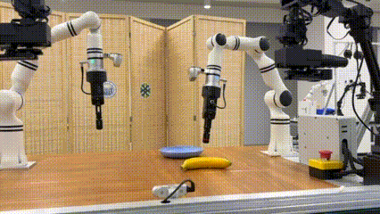
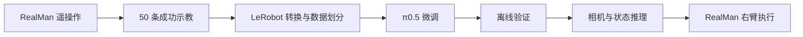

# π0.5 × RealMan：香蕉抓放 🍌

**50 条遥操作示教 → π0.5 微调 → RealMan 真机部署。**

基于预训练 [π0.5 base](https://huggingface.co/lerobot/pi05_base)，我完成了香蕉抓放任务的微调与真机部署：RealMan 右臂抓起人工香蕉，放入右侧蓝盘，松爪后抬离。

**亮点：2026 年 11 月 8 日现场测试中，Expert-only checkpoint 成功 9/10 次（90%）。**

[English](README.md) · [实验详情](docs/experiment.md) · [流程与接口](docs/reproduction.md)

## 演示

**[观看演示视频（MP4）](assets/expert_pick_place_2x.mp4)** · GIF 为 4 倍速，MP4 为 2 倍速。

## 实验结果

| 微调方法 | 选用 checkpoint | 成功次数 |
|---|---:|---:|
| **Expert-only** | **4,000 updates** | **9/10（90%）** |
| LoRA（r=16，α=16） | 2,500 updates | 0/8 |

以上为现场初步测试结果，尚非严格控制条件下的方法对比：测试期间执行器有过调整，起始条件也未完全统一。完整实验记录见[实验详情](docs/experiment.md)。

现场还观察到了对香蕉小幅位置变化的适应，以及物体被移走后的再次尝试抓取，后续将进一步定量测试。

## 从示教到真机

| 项目 | 配置 |
|---|---|
| 数据 | 50 条示教：TRAIN 40 / VAL 5 / TEST 5 |
| 输入 | 3 路 RGB（上方、左腕、右腕）、14 维机器人状态、任务指令 |
| 输出 | 14 维关节及夹爪目标；真机只执行右臂部分 |
| 训练 | AMD gfx1100，约 48 GiB 显存，ROCm 7.2 |
| 部署 | NVIDIA RTX 3060，12 GB |

实验基于实验室现有的遥操作与机器人控制平台。归一化统计仅使用 TRAIN，checkpoint 根据 VAL 选择，TEST 不参与选模。

## 仓库内容

- [实验详情](docs/experiment.md)：训练设置、测试记录及评估条件。
- [流程与接口](docs/reproduction.md)：采集、数据转换、模型接口与部署检查。
- [现场结果摘要](results/pilot_summary.json)及上方演示视频。

当前公开的是**演示与实验文档**；原始示教、任务权重和实验室专用控制代码暂未包含。

## 下一步

- 固定执行器与起始条件，开展可重复评测。
- 定量测试物体位置扰动与恢复行为。
- 分析 LoRA 初始动作偏移与 action-chunk 不连续问题。

## 致谢

基于 [Physical Intelligence OpenPI](https://github.com/Physical-Intelligence/openpi) 和 [Hugging Face LeRobot](https://github.com/huggingface/lerobot)。感谢实验室学长搭建和维护 RealMan 真机、遥操作、数据采集及控制平台。
